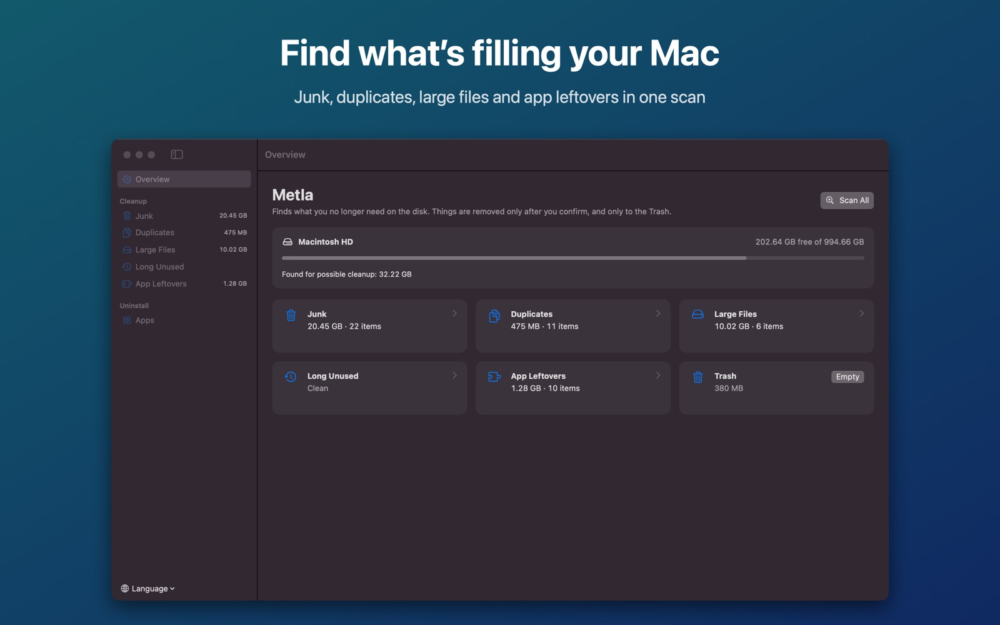
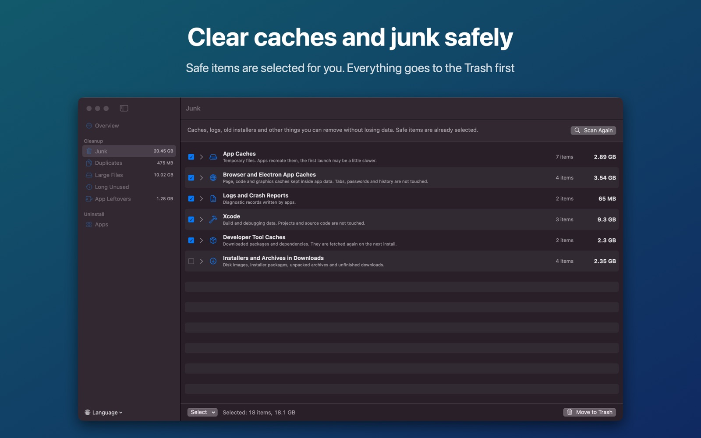
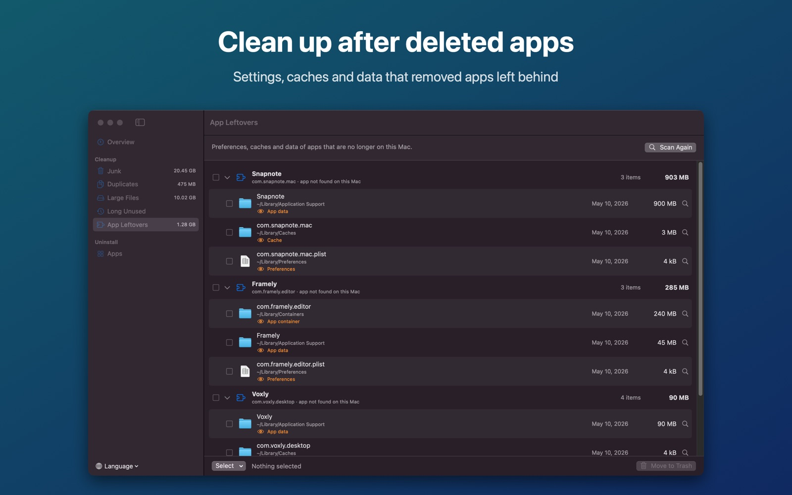

# Metla

A small native macOS app that finds what is filling your disk and helps you clear it out safely: junk, duplicates, large files, files you have not opened for a long time, and the leftovers of apps you deleted.

Everything runs **locally**. Metla makes no network connections and collects nothing. Nothing is removed without your confirmation, and everything goes to the **Trash** first, so you can always put it back.

<p align="center">
  
</p>
<p align="center">
  
  &nbsp;
  
</p>

## Features

- **Junk** — app caches, Chromium and Electron caches, logs, Xcode DerivedData and DeviceSupport, simulator caches, and package manager caches (npm, pnpm, Yarn, Bun, Gradle, Maven, CocoaPods, Swift Package Manager, Cargo, Go, pub, NuGet, Homebrew, pip). Also installers in Downloads, archives you already unpacked, and old screenshots.
- **Duplicates** — files with exactly the same contents, compared by content, not by name. The likely original is marked, and one click selects every extra copy.
- **Large files** and **long unused files** — pick the folder, the size threshold and the period yourself.
- **App leftovers** — settings, caches and data in `~/Library` that belong to apps no longer installed, plus launch agents that point to programs that no longer exist.
- **Uninstaller** — every app with its size and last-used date; remove an app together with its Library files.
- **Advice on every item** — a short explanation and one of three safety levels. Only data that apps recreate on their own is preselected.
- 12 interface languages (English, Russian, Spanish, German, French, Portuguese, Italian, Chinese, Japanese, Korean, Hindi, Arabic), with a right-to-left layout for Arabic.
- About 3 MB, no background processes, no login item, no menu bar agent.

## Install

1. Download `Metla.dmg` from the [latest release](https://github.com/sergey-lee/metla/releases).
2. Open it and drag **Metla** to **Applications**.
3. Launch it and click **Scan All**. macOS asks once for access to Desktop, Documents and Downloads — allow it, or those folders are skipped.

Optional: to include the Trash, Mail data, device backups and some app containers, give Metla **Full Disk Access** in System Settings → Privacy & Security, then reopen the app. The Overview screen has a shortcut to that pane.

The released DMG is signed with a Developer ID and notarized by Apple, so it opens with a normal double-click. Requires macOS 15 or later, Apple silicon or Intel.

## How it works

| Check | What it looks at |
|-------|------------------|
| Junk | Known cache and log locations in `~/Library`, developer tool caches in the home folder, `~/Downloads`, the Desktop |
| Duplicates | Files of the same size, then a sampled SHA-256 hash, then a full hash. Hard links to the same data are not counted |
| Large / long unused | File sizes and the latest of the opened, modified, created and added dates; Spotlight's last-used date where available |
| App leftovers | Bundle identifiers in `~/Library` that match no installed app, including helpers shipped inside apps |
| Uninstaller | `/Applications` and `~/Applications`, plus the app's own files in `~/Library` |

## Safety

- Removal always means **Move to Trash**. The only permanent action is **Empty Trash**, behind its own confirmation.
- Caches of apps that are running during the scan are not preselected.
- Leftovers that changed during the last week, or whose developer still has another app installed, are marked "caution" because they may still be in use or shared.
- iCloud Drive and other cloud storage folders are never scanned, and cloud-only files are never downloaded as a side effect of a scan.
- Data that belongs to macOS and Apple's apps is never offered and cannot be moved, whatever a scan returns: everything named `com.apple…` in a Library folder (Xcode's caches, accounts and sessions included), the keychains, and Apple's system folders such as GeoServices or CloudKit. The one exception is Mail's copies of opened attachments.
- A cache folder with a plain name is listed only when it belongs to an installed app or a known tool, so unknown system folders are left alone.
- System folders and the top-level folders of your home directory can never be moved, whatever a scan returns.

## Build from source

Requires macOS 15+, Xcode 26+ (Swift 6.2).

Quick local build, no Xcode project needed:

```bash
Scripts/build.sh          # → build/Metla.app
```

The Xcode project is generated from [`project.yml`](project.yml) with [XcodeGen](https://github.com/yonaskolb/XcodeGen) (`brew install xcodegen`); the `.xcodeproj`, generated Info.plists and entitlements are not committed.

```bash
xcodegen generate
xcodebuild -scheme MetlaDirect -configuration Release -allowProvisioningUpdates build
```

Every scan can also be run in text mode, which prints what it finds and removes nothing:

```bash
build/Metla.app/Contents/MacOS/Metla --cli junk
```

Use `duplicates`, `large`, `old`, `leftovers` or `apps` instead of `junk`; `--root <folder>` limits the search to one folder.

### Translations

All interface text lives in [`Resources/Localizable.xcstrings`](Resources/Localizable.xcstrings). The source language of the catalog is Russian: the keys are the Russian strings in the code. After changing text in the code, run:

```bash
Scripts/sync_strings.sh   # re-extracts strings, keeps translations, lists what is missing
```

### Cutting a release (maintainers)

```bash
# one-time: store notary credentials
xcrun notarytool store-credentials redline-notary \
  --apple-id "you@example.com" --team-id 4GZ4AH8Z6M --password "app-specific-password"

./release.sh            # archive → Developer-ID export → DMG → notarize → staple
```

Upload the resulting `dist/Metla.dmg` to GitHub Releases.

## Support

If Metla frees up some space for you, you can [buy me a coffee ☕](https://github.com/sponsors/sergey-lee).

## License

[MIT](LICENSE) © 2026 Sergey Li
